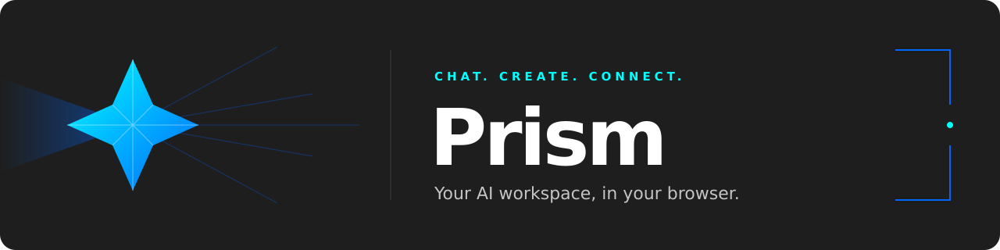
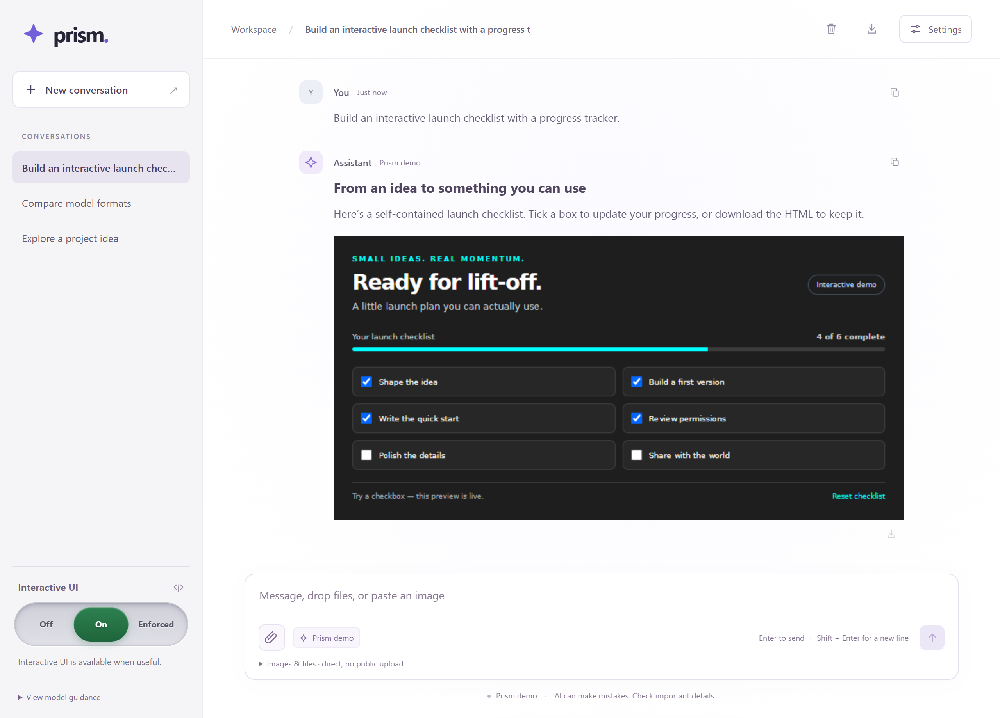
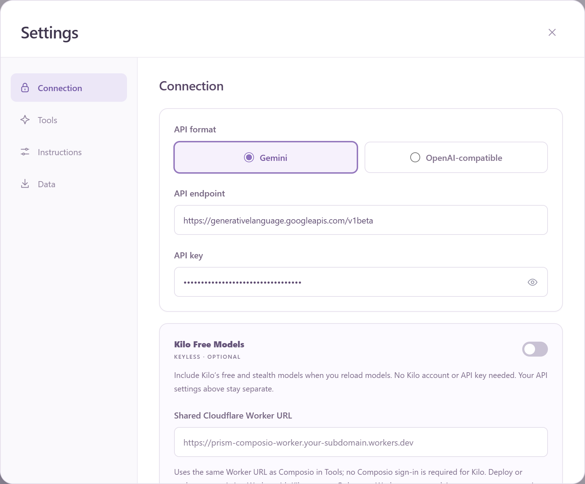

<p align="center">
  
</p>

<h1 align="center">Your models. Your workspace.</h1>

<p align="center">
  A browser-based AI workspace for conversations, files and interactive ideas.<br>
  Connect your provider. Bring your context. Make something useful.
</p>

<p align="center">
  <a href="https://github.com/radianceskills-dev/Prism/actions/workflows/ci.yml"></a>
  <a href="https://github.com/radianceskills-dev/Prism/releases/latest"></a>
  <a href="./LICENSE"></a>
  <a href="#quick-start"></a>
</p>

<p align="center">
  <a href="https://prism-webchat.netlify.app/">Open Prism</a> ·
  <a href="#quick-start">Quick start</a> ·
  <a href="#built-for-more-than-chat">Features</a> ·
  <a href="./docs/guide.md">User &amp; developer guide</a> ·
  <a href="#privacy--trust">Privacy</a> ·
  <a href="./CONTRIBUTING.md">Contribute</a>
</p>

<p align="center">
  
</p>
<p align="center"><sub>Real Prism interface, scripted demo conversation. The checklist is interactive; no live model or connected accounts were used.</sub></p>

## Built for more than chat

| Capability | What you can do |
| :--- | :--- |
| **Choose your connection** | Use Gemini or OpenAI-compatible Chat Completions APIs, including compatible local servers that allow browser requests. Switch models without switching workspaces. |
| **Bring your context** | Attach images, PDFs and UTF-8 text/code directly to a compatible model. No automatic public file upload or attachment proxy. |
| **Turn answers into tools** | Render interactive HTML previews in sandboxed frames. Try a prototype, work through a small app, or download the HTML to keep it. |
| **Connect when you need to** | Opt into direct Parallel web search and Notion workspace tools, or connect Composio integrations through your own Cloudflare Worker. |

Your drafts, conversations and settings are saved in this browser. Prism itself is a **static app with no application backend**; optional Kilo/Composio features use a separately deployed, user-owned Worker. Enabled integrations and model providers receive the data needed for their requests.

## Quick start

**Node.js 20+** for the app; **22.12+** for the complete app/Worker development setup.

```sh
git clone --recurse-submodules https://github.com/radianceskills-dev/Prism.git
cd Prism
npm start
```

Open **http://127.0.0.1:3000**. No `npm install` is needed for preview or build. On Windows you can also run [Start-Prism.cmd](./Start-Prism.cmd).

1. Open **Settings → Connection**.
2. Choose **Gemini** or **OpenAI-compatible**, then set your provider's **base URL** and API key. A local server may allow a blank key.
3. Click **Reload models**, choose a compatible model and send your first message.

The server must support the selected API format **and browser CORS**. OpenAI-compatible means Chat Completions, not the Responses API. File support and function calling depend on your model/provider. [Connection details →](./docs/guide.md#api-formats)

<details>
<summary><strong>See the connection settings</strong></summary>

<p>
  
</p>

Connection settings, model discovery and tool controls are part of the app—not a separate service dashboard. The screenshot uses a nonfunctional demo credential and a mocked model list.

</details>

<details>
<summary><strong>Optional: Kilo free models and Composio</strong></summary>

Deploy the [shared Worker](https://github.com/radianceskills-dev/prism-composio-worker) to **your own Cloudflare account**, then paste the same Worker URL into Prism's Kilo and Composio settings. Their URL fields stay synchronized.

- **Kilo Free Models:** enable the option in Connection, then reload models. No Kilo API key or Composio login is needed; availability and quotas depend on the upstream service.
- **Composio:** connect only the apps and scopes you intend to use. The Worker handles the fixed MCP/OAuth routes; it is not an arbitrary API proxy.

[](https://deploy.workers.cloudflare.com/?url=https%3A%2F%2Fgithub.com%2Fradianceskills-dev%2Fprism-composio-worker)

Read the [Worker setup and permission boundaries](./docs/guide.md#composio-bring-your-own-cloudflare-worker) before connecting real accounts. The static app works without this deployment.

</details>

## Explore the guide

The landing page is the tour. The [full guide](./docs/guide.md) keeps the technical details, compatibility notes and limits in one place.

| Start here | Go deeper |
| :--- | :--- |
| [Configure your workspace](./docs/guide.md#configure) | [API formats and local servers](./docs/guide.md#api-formats) |
| [Images, PDFs and text files](./docs/guide.md#direct-images-and-files) | [Attachment limits, persistence and exports](./docs/guide.md#direct-images-and-files) |
| [Interactive HTML artefacts](./docs/guide.md#interactive-html-artefacts) | [Isolation and limitations](./docs/guide.md#isolation-and-limitations) |
| [Parallel web search](./docs/guide.md#parallel-public-web-search) | [Notion workspace permissions](./docs/guide.md#notion-workspace-tools) |
| [Kilo free models](./docs/guide.md#kilo-free-models) | [Composio transport and OAuth](./docs/guide.md#transport-and-oauth-identity) |
| [Build and deploy](./docs/guide.md#build-and-deploy) | [Tests](./docs/guide.md#tests) · [Source map](./docs/guide.md#source) |

## Privacy & trust

Local-first describes where the workspace is stored—not a promise that your data never leaves the browser.

> [!IMPORTANT]
> **Browser storage is not encrypted.** Sending a message shares relevant history/files with your chosen provider. Enabled tools can send data to services and may mutate connected apps without a separate per-call approval.
>
> Prism also loads Tailwind's browser runtime from jsDelivr at a **floating major version without SRI**. That script runs with page privileges and can access page data/storage. Review or self-host/pin the dependency before using a high-assurance deployment.

See the [full security and privacy notes](./docs/guide.md#security-and-privacy) and [private vulnerability reporting policy](./SECURITY.md). Interactive previews have their own [documented sandbox limits](./docs/guide.md#isolation-and-limitations). External service terms, quotas and data policies still apply.

## Build something with us

Prism is **HTML, CSS and browser ES modules**, with no runtime npm dependencies. Preview and static export use Node's built-in APIs; the development test suite uses Playwright with Microsoft Edge.

```sh
npm ci --ignore-scripts
npm test
npm --prefix composio-worker test
npm run build
```

The export contains **23 public assets plus `_headers`**, including the license and third-party notices. Deploy the generated `dist` directory to a compatible static host. [GitHub Releases](https://github.com/radianceskills-dev/Prism/releases/latest) provide a ready-built static ZIP and SHA-256 checksum; extract and serve it over HTTP(S), not `file://`. Source-repository publication does not deploy a hosted app or Worker.

Prism **1.0.0** is the first stable release. See the [changelog](./CHANGELOG.md) and [versioning and release policy](./docs/releases.md). The [hosted app](https://prism-webchat.netlify.app/) requires your own provider configuration and credentials.

For browser tests, keep `npm start` running in another terminal, then run `npm run test:browser` with Edge installed. Use a recursive clone: GitHub source ZIP downloads omit the Worker submodule. [Development and contribution guide →](./CONTRIBUTING.md)

---

<p align="center">
  <strong>Open source. Yours to explore.</strong><br>
  <a href="./LICENSE">MIT license</a> ·
  <a href="./THIRD_PARTY_NOTICES.md">Third-party notices</a> ·
  <a href="./SECURITY.md">Security</a> ·
  <a href="https://github.com/radianceskills-dev/Prism/issues">Issues</a>
</p>
